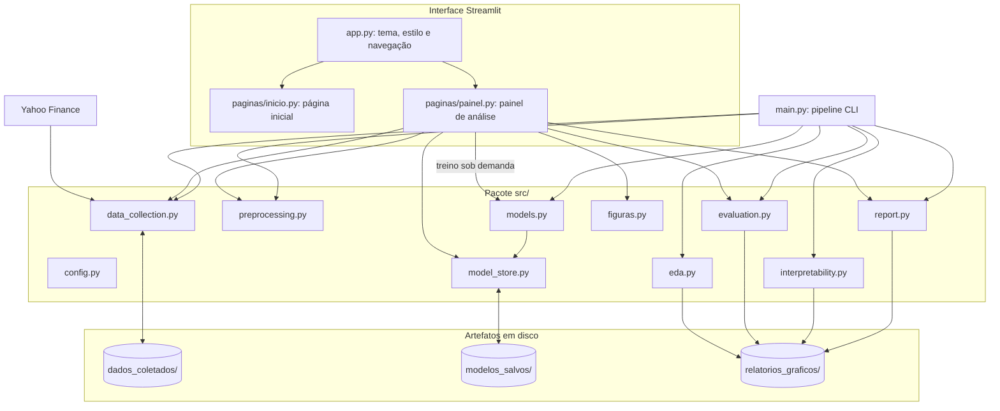

# Documentação Técnica e Metodológica

**Previsão de Riscos Financeiros com Data Science e Machine Learning**

| | |
|---|---|
| **Instituição** | Universidade Federal do Piauí (UFPI) |
| **Centro** | Centro de Educação Aberta e a Distância (CEAD) |
| **Curso** | Curso Superior de Tecnologia em Gestão de Dados |
| **Orientador** | Prof. Dr. Arlino Henrique Magalhães de Araújo |
| **Autora** | Lorrana Evelyn de Araújo Pereira |
| **Ano** | 2026 |
| **Repositório** | [github.com/cleristoncramos/Previsao_Financial_Risk](https://github.com/cleristoncramos/Previsao_Financial_Risk) |

Este documento detalha a fundamentação teórica, a formulação matemática, a arquitetura de software, os módulos, os algoritmos, a validação, os resultados e a operação do sistema. Para uma visão geral e o guia rápido de uso, consulte o [README](README.md).

---

## Sumário

1. [Visão geral e problema de pesquisa](#1-visão-geral-e-problema-de-pesquisa)
2. [Fundamentação teórica e formulação matemática](#2-fundamentação-teórica-e-formulação-matemática)
3. [Dados e dicionário de variáveis](#3-dados-e-dicionário-de-variáveis)
4. [Arquitetura do sistema](#4-arquitetura-do-sistema)
5. [Módulos e funções](#5-módulos-e-funções)
6. [Algoritmos e hiperparâmetros](#6-algoritmos-e-hiperparâmetros)
7. [Validação e métricas de avaliação](#7-validação-e-métricas-de-avaliação)
8. [Inteligência Artificial Explicável (XAI)](#8-inteligência-artificial-explicável-xai)
9. [Resultados do ativo de referência](#9-resultados-do-ativo-de-referência)
10. [Painel interativo](#10-painel-interativo)
11. [Guia de operação](#11-guia-de-operação)
12. [Artefatos gerados](#12-artefatos-gerados)
13. [Governança de dados e reprodutibilidade](#13-governança-de-dados-e-reprodutibilidade)
14. [Limitações e trabalhos futuros](#14-limitações-e-trabalhos-futuros)
15. [Referências bibliográficas](#15-referências-bibliográficas)

---

## 1. Visão geral e problema de pesquisa

O mercado de capitais é marcado por alta volatilidade, comportamento não linear e sensibilidade a choques macroeconômicos e geopolíticos. Medir e antecipar essa volatilidade é central na gestão de risco de mercado, na precificação de derivativos, na alocação de carteiras e nas exigências regulatórias (como os acordos de Basileia).

### Objetivo
Desenvolver e avaliar um pipeline de Ciência de Dados, de ponta a ponta, capaz de prever a **volatilidade histórica anualizada em janela móvel de 21 pregões, um pregão à frente (t+1)**, comparando modelos de Machine Learning com uma regra simples de referência, explicando as previsões e convertendo o risco projetado em Value at Risk.

### Escopo
- **Ativo de referência:** IBOVESPA (`^BVSP`).
- **Demais ativos:** S&P 500 (`^GSPC`) e as ações Petrobras (`PETR4.SA`), Vale (`VALE3.SA`), Itaú Unibanco (`ITUB4.SA`), Bradesco (`BBDC4.SA`) e Ambev (`ABEV3.SA`).
- **Abordagens comparadas:** XGBoost, LightGBM, Rede Neural MLP e baseline de persistência.

### Relevância para Gestão de Dados
- **Qualidade e integridade:** coleta automatizada de preços ajustados por proventos e desdobramentos.
- **Temporalidade estrita:** prevenção de vazamento de dados (*data leakage*) e de viés de antecipação (*look-ahead bias*).
- **Transparência algorítmica:** explicações globais e locais (XAI) para auditoria e governança dos modelos.
- **Comunicação:** painel interativo, relatórios e arquivos exportáveis no padrão brasileiro.

---

## 2. Fundamentação teórica e formulação matemática

### 2.1. Retorno diário aritmético

$$R_t = \frac{P_t - P_{t-1}}{P_{t-1}} = \frac{P_t}{P_{t-1}} - 1$$

Em que $P_t$ é o preço de fechamento ajustado no pregão $t$.

### 2.2. Volatilidade histórica anualizada (janela de 21 pregões)
Desvio-padrão amostral dos retornos nos últimos $N = 21$ pregões (cerca de um mês de negociação), anualizado por $\sqrt{252}$:

$$\sigma_{t,21} = \sqrt{\frac{1}{N - 1} \sum_{i=0}^{N-1} \left( R_{t-i} - \bar{R}_t \right)^2} \times \sqrt{252}, \qquad \bar{R}_t = \frac{1}{N} \sum_{i=0}^{N-1} R_{t-i}$$

O valor 252 é o número médio de pregões por ano. A implementação usa `rolling(21).std()` do pandas, que aplica o denominador $N - 1$.

### 2.3. Variável-alvo
Regressão supervisionada um passo à frente:

$$y_t = \sigma_{t+1,21}$$

Construída com `shift(-1)` sobre a série de volatilidade. A última linha da série, que ainda não tem t+1, fica fora da modelagem e é usada apenas para a projeção do próximo pregão.

### 2.4. Índice de Força Relativa (RSI, 14 pregões)

$$RSI = 100 - \frac{100}{1 + RS}, \qquad RS = \frac{\overline{G}_{14}}{\overline{L}_{14}}$$

Em que $\overline{G}_{14}$ e $\overline{L}_{14}$ são as **médias simples** dos ganhos e das perdas diárias nos últimos 14 pregões (a implementação usa média móvel simples, não a suavização exponencial de Wilder). Quando não há perdas na janela, o valor fica indefinido e é tratado como ausente.

### 2.5. Médias móveis simples

$$MM_{k,t} = \frac{1}{k} \sum_{i=0}^{k-1} P_{t-i}, \qquad k \in \{20, 50\}$$

A média móvel do volume usa a mesma definição, com $k = 20$.

### 2.6. Baseline de persistência
Previsão ingênua que repete a volatilidade observada no pregão atual:

$$\hat{y}_t = \sigma_{t,21}$$

É o patamar mínimo que um modelo precisa superar para agregar valor preditivo. Como de um pregão para o seguinte 20 dos 21 retornos da janela se repetem, a volatilidade em janela móvel é muito persistente e esse baseline é exigente.

### 2.7. Fatos estilizados dos retornos
- **Assimetria (skewness):** valores negativos indicam cauda mais longa à esquerda (quedas extremas mais frequentes que altas extremas).
- **Curtose em excesso (Fisher):** calculada pelo pandas, vale 0 para a distribuição Normal. Valores positivos indicam caudas pesadas (distribuição leptocúrtica).

No ^BVSP, a assimetria é −0,69 e a curtose em excesso é 15,39 (equivalente a uma curtose de 18,39, contra 3 da Normal), o que confirma caudas pesadas.

### 2.8. Value at Risk paramétrico de um dia
A volatilidade anual projetada $\hat{\sigma}_{anual}$ é convertida para a escala diária e multiplicada pelo quantil da Normal padrão:

$$VaR_{\alpha} = z_{\alpha} \times \frac{\hat{\sigma}_{anual}}{\sqrt{252}} \times W$$

Com $z_{95\%} = 1{,}644853$, $z_{99\%} = 2{,}326348$ e $W$ o patrimônio exposto. O modelo assume retornos normais com média zero no horizonte de um dia; diante das caudas pesadas (seção 2.7), tende a subestimar perdas extremas.

### 2.9. Regime de risco
A volatilidade projetada é classificada pelos percentis da volatilidade histórica **do próprio ativo** ($P_{25}$, $P_{75}$ e $P_{95}$):

| Regime | Condição |
|---|---|
| Baixo | $\hat{\sigma} < P_{25}$ |
| Moderado | $P_{25} \le \hat{\sigma} < P_{75}$ |
| Elevado | $P_{75} \le \hat{\sigma} < P_{95}$ |
| Extremo | $\hat{\sigma} \ge P_{95}$ |

Limites relativos evitam que ativos naturalmente mais voláteis (ações) apareçam sempre como "extremos" quando comparados a um índice. No ^BVSP, os limites são 14,66%, 22,78% e 32,63%.

---

## 3. Dados e dicionário de variáveis

- **Fonte:** Yahoo Finance, via `yfinance`, com `auto_adjust=True` (preços ajustados por proventos e desdobramentos).
- **Frequência e período:** diária, de 01/01/2016 até a data da coleta.
- **Armazenamento:** `dados_coletados/indices/` (`IDX_BVSP.csv`, `IDX_GSPC.csv`) e `dados_coletados/acoes_br/` (`PETR4.csv`, `VALE3.csv`, `ITUB4.csv`, `BBDC4.csv`, `ABEV3.csv`).

| Coluna | Tipo | Origem / cálculo | Papel | Interpretação |
|---|---|---|---|---|
| `Data` | data | Yahoo Finance | Eixo temporal | Data do pregão |
| `Open`, `High`, `Low` | real | Yahoo Finance | Informativa | Abertura, máxima e mínima ajustadas |
| `Close` | real | Yahoo Finance | *Feature* | Fechamento ajustado |
| `Volume` | inteiro | Yahoo Finance | *Feature* | Quantidade de ações (ou contratos) negociada no pregão |
| `Retorno_Diario` | real | `Close.pct_change()` | *Feature* | Variação diária do fechamento |
| `Volatilidade_21d` | real | $std(R_{21}) \times \sqrt{252}$ | *Feature* | Volatilidade anualizada da janela de 21 pregões |
| `MM_20d` | real | média de 20 fechamentos | *Feature* | Tendência de curto prazo |
| `MM_50d` | real | média de 50 fechamentos | *Feature* | Tendência de médio prazo |
| `RSI_14d` | real | seção 2.4, escala 0 a 100 | *Feature* | *Momentum*: acima de 70, sobrecompra; abaixo de 30, sobrevenda |
| `Volume_MM20` | real | média de 20 volumes | *Feature* | Liquidez média recente |
| `Target_Vol` | real | `Volatilidade_21d.shift(-1)` | **Alvo** | Volatilidade do pregão seguinte (t+1) |

As janelas móveis deixam vazias as primeiras observações de cada série (até 50 pregões, por causa da `MM_50d`). Essas linhas são removidas antes da modelagem.

---

## 4. Arquitetura do sistema

O sistema tem três camadas: a **interface** em Streamlit, o **pacote de domínio** `src/`, reutilizado pela interface e pelo pipeline em linha de comando, e os **artefatos** persistidos em disco.



### Princípios de engenharia
1. **Configuração centralizada:** caminhos, ativos, janelas, hiperparâmetros, proporção de teste, semente e fuso horário em `src/config.py`.
2. **Estrutura tipada:** a *dataclass* `DatasetModelagem` transporta matrizes, alvo, datas, *scaler* e nomes das *features* entre as etapas.
3. **Prevenção de vazamento:** divisão estritamente sequencial (sem embaralhamento); `StandardScaler` ajustado só no treino; *Early Stopping* da MLP validado no fim do treino, nunca no teste.
4. **Modelos por ativo:** cada ativo tem os próprios modelos e *scaler* (`src/model_store.py`), e um modelo nunca é aplicado a outra série. O ativo de referência fica na raiz de `modelos_salvos/` e os demais em `modelos_salvos/por_ativo/<ATIVO>/`.
5. **Inferência com o *scaler* do treino:** o painel transforma os dados com o *scaler* salvo junto aos modelos.
6. **Cache na interface:** `st.cache_data` e `st.cache_resource` evitam recarregar dados e modelos e recalcular validação cruzada, SHAP, LIME e figuras a cada interação. As chaves incluem o ativo, a data final da série, a versão do modelo e, quando aplicável, o pregão escolhido.
7. **Padrão brasileiro e fuso oficial:** números no formato brasileiro em toda a interface e nos arquivos exportados; horário obtido por `agora_brasilia()` (fuso `America/Sao_Paulo`), independente do fuso do servidor.

---

## 5. Módulos e funções

### 5.1. `src/config.py`
- `ATIVOS`: ações (`PETR4.SA`, `VALE3.SA`, `ITUB4.SA`, `BBDC4.SA`, `ABEV3.SA`) e índices (`^BVSP`, `^GSPC`).
- `TICKER_REF = "^BVSP"`, `DATA_INICIO = "2016-01-01"`, `DATA_FIM` (data atual em Brasília), `INTERVALO = "1d"`.
- Janelas: volatilidade 21, médias 20 e 50, RSI 14, volume 20.
- `FEATURES` (8 variáveis), `TARGET = "Target_Vol"`, `TEST_SIZE = 0.20`, `RANDOM_STATE = 42`.
- `XGBOOST_PARAMS`, `LIGHTGBM_PARAMS`, `NEURAL_NETWORK_PARAMS`.
- `FUSO_HORARIO` e `agora_brasilia()`: data e hora no fuso de São Paulo (UTC−3 fixo se o sistema não tiver a base de fusos).

### 5.2. `src/data_collection.py`
- `calcular_rsi()`: RSI por médias simples, com proteção contra divisão por zero.
- `engenharia_atributos()`: retorno, volatilidade anualizada, médias móveis, RSI e média de volume.
- `baixar_ativo()`: download no Yahoo Finance, com tratamento de colunas em MultiIndex.
- `salvar_ativo_csv()`: grava o CSV na subpasta da categoria.
- `coletar_todos_ativos()`: baixa, enriquece e salva todos os ativos.
- `carregar_ativo_local()`: lê o CSV do ativo sem acessar a rede.

### 5.3. `src/eda.py` (pipeline)
- `obter_estatisticas_descritivas()`: estatísticas descritivas da série.
- `plotar_fechamento_medias()`, `plotar_volatilidade_historica()`: gráficos HTML interativos.
- `plotar_distribuicao_retornos()`: histograma com densidade e Q-Q plot.
- `plotar_matriz_correlacao()`: mapa de calor do triângulo inferior das correlações.
- `executar_eda_completa()`: orquestra a análise exploratória.

### 5.4. `src/preprocessing.py`
- `DatasetModelagem`: matrizes de treino e teste (originais e padronizadas), alvo, datas, *features*, *scaler* e propriedades `X`, `y` e `datas` da série completa.
- `preparar_dados_modelagem()`: cria o alvo t+1, remove linhas incompletas, divide 80/20 em ordem temporal e padroniza.

### 5.5. `src/models.py`
- `treinar_xgboost()`, `treinar_lightgbm()`: ajuste dos modelos de árvores.
- `construir_rede_neural()`: MLP com *Dropout* e camada `Rescaling` de saída.
- `treinar_rede_neural()`: treino com *Early Stopping* sobre os últimos 15% do treino.
- `treinar_todos_modelos()`: treina os três modelos em sequência e, se solicitado, salva modelos, *scaler*, histórico da MLP e metadados.

### 5.6. `src/model_store.py`
- `pasta_modelos_ativo()`: pasta de modelos de cada ativo.
- `modelos_existem()`, `salvar_modelos_treinados()`, `carregar_modelos_salvos()`: persistência dos modelos (XGBoost e LightGBM em `joblib`, MLP em `.keras`), do *scaler* e de `metadados_modelos.json` (ativo, data de salvamento no horário de Brasília, *features*, tamanhos de treino e teste, métricas e histórico de perda da MLP).
- `predizer_com_modelos()`: gera as previsões de todos os modelos carregados.

### 5.7. `src/evaluation.py`
- `calcular_metricas()`: RMSE, MAE e R².
- `avaliar_todos_modelos()`: tabela de métricas ordenada por RMSE.
- `adicionar_baseline_ingenuo()`: inclui o baseline de persistência nas previsões.
- `validacao_cruzada_temporal()`: `TimeSeriesSplit` com 5 folds para o XGBoost.
- `plotar_real_vs_predicoes()`, `plotar_curva_aprendizado_nn()`: gráficos de avaliação do pipeline.

### 5.8. `src/interpretability.py` (pipeline)
- `explicar_com_shap()`: importância global, beeswarm e waterfall de uma amostra.
- `explicar_com_lime()`: explicação local de uma amostra.

### 5.9. `src/figuras.py` (painel)
- `figuras_exploratorias()`, `figuras_avaliacao()`, `figuras_interpretabilidade()`: geram em memória as 12 figuras PNG do catálogo, todas com 1600 × 1000 px.
- `triangulo_inferior()`: mantém cada par de ativos uma única vez na matriz de correlação.
- `numero_brasileiro()` e `formatar_condicao_lime()`: convertem números de textos e rótulos para o padrão brasileiro.

### 5.10. `src/report.py`
- `montar_texto_relatorio()`: relatório consolidado em seções (dados e metodologia, desempenho, comparação com o benchmark, validação cruzada e conclusão).
- `classificar_modelos()`: rótulos de menor RMSE geral, melhor modelo de ML e benchmark.
- `metricas_para_csv()`, `dados_para_csv()`: exportações em CSV no padrão do Excel em português.
- `gerar_relatorio_final()`: grava o relatório e as métricas do pipeline em `relatorios_graficos/`.

### 5.11. Interface
- `app.py`: configuração da página, tema, injeção do `assets/style.css` e navegação (`st.navigation`) entre a página inicial (rota `/`) e o painel (rota `/painel`).
- `paginas/inicio.py`: página inicial e janela de informações acadêmicas (`st.dialog`).
- `paginas/painel.py`: painel de análise, com as funções em cache, o padrão visual dos painéis e gráficos, o treino sob demanda e a montagem das seis abas.

### 5.12. `main.py`
Pipeline em linha de comando (`argparse`) com as opções `--etapa`, `--usar-dados-locais`, `--nao-mostrar-graficos`, `--ticker` e `--carregar-modelos`.

### 5.13. `scripts/`
- `rasterizar_logos.py`: converte os logotipos SVG em PNG (Chrome ou Edge em modo headless) para uso no vídeo.
- `gerar_video_apresentacao.py`: gera o vídeo da página inicial a partir dos dados e modelos reais.

---

## 6. Algoritmos e hiperparâmetros

### 6.1. XGBoost Regressor
Árvores de decisão adicionadas sequencialmente, cada uma corrigindo os resíduos das anteriores, minimizando uma perda regularizada:

$$\mathcal{L}^{(t)} = \sum_{i=1}^{n} l\left(y_i, \hat{y}_i^{(t-1)} + f_t(x_i)\right) + \Omega(f_t)$$

`n_estimators` 500, `learning_rate` 0,05, `max_depth` 5, `subsample` 0,8, `colsample_bytree` 0,8.

### 6.2. LightGBM Regressor
*Gradient boosting* com histogramas e crescimento de árvores por folha (*leaf-wise*).

`n_estimators` 500, `learning_rate` 0,05, `num_leaves` 31, `subsample` 0,8, `colsample_bytree` 0,8.

### 6.3. Rede Neural MLP (Keras)
- Entrada com as 8 *features* padronizadas.
- Camadas densas de 128, 64 e 32 neurônios com ReLU; *Dropout* de 10% após as duas primeiras.
- Saída linear seguida de `Rescaling` ($\hat{y} = z \cdot \sigma_y + \mu_y$, com média e desvio do alvo no treino): a rede aprende em escala padronizada e devolve a volatilidade na escala original.
- Otimizador Adam (taxa 0,001), perda MSE, até 200 épocas, lote de 32.
- *Early Stopping* com paciência de 20 épocas sobre os últimos 15% do treino (`validation_split`, que preserva a ordem temporal), restaurando os melhores pesos.
- *Batch Normalization* foi descartada: com o alvo de baixa magnitude, levava a R² negativo no teste.

### 6.4. Baseline de persistência
$\hat{y}_t = \sigma_{t,21}$ (seção 2.6), sem treinamento.

---

## 7. Validação e métricas de avaliação

### 7.1. Divisão temporal
Os primeiros 80% das observações formam o treino e os 20% finais, o teste, sem embaralhamento. O teste simula o uso real: o modelo só conhece o passado.

### 7.2. Validação cruzada temporal (`TimeSeriesSplit`)
A validação *K-fold* tradicional mistura passado e futuro e infla as métricas em séries temporais. A validação temporal usa janelas progressivas:

- Fold 1: treino em $T_1$, validação em $T_2$.
- Fold 2: treino em $T_1 \cup T_2$, validação em $T_3$.
- …
- Fold 5: treino em $T_1 \cup \dots \cup T_5$, validação em $T_6$.

É aplicada ao XGBoost sobre a série completa, com o *scaler* ajustado dentro de cada fold.

### 7.3. Métricas

$$RMSE = \sqrt{\frac{1}{n} \sum_{i=1}^{n} (y_i - \hat{y}_i)^2} \qquad MAE = \frac{1}{n} \sum_{i=1}^{n} |y_i - \hat{y}_i| \qquad R^2 = 1 - \frac{\sum (y_i - \hat{y}_i)^2}{\sum (y_i - \bar{y})^2}$$

- **RMSE:** penaliza mais os erros grandes, importantes em risco de cauda.
- **MAE:** erro médio na escala da volatilidade.
- **R²:** proporção da variância explicada; valores negativos indicam desempenho pior que prever a média.

RMSE e MAE ficam na escala da volatilidade anualizada (0,01 = 1 ponto percentual).

### 7.4. Comparação com o baseline
A diferença relativa entre o melhor modelo de Machine Learning e o baseline é:

$$\Delta = \frac{RMSE_{modelo} - RMSE_{baseline}}{RMSE_{baseline}} \times 100$$

Valores positivos indicam que o modelo ficou **acima** do baseline (pior); negativos, **abaixo** (melhor). O painel e o relatório exibem essa comparação explicitamente.

---

## 8. Inteligência Artificial Explicável (XAI)

### 8.1. SHAP
Baseado nos valores de Shapley da teoria dos jogos cooperativos, decompõe cada previsão na soma das contribuições das variáveis:

$$\hat{y}(x) = \phi_0 + \sum_{j=1}^{M} \phi_j(x)$$

Em que $\phi_0$ é o valor esperado do modelo e $\phi_j(x)$ a contribuição da variável $j$. Usa-se o `TreeExplainer` sobre o XGBoost, nos dados de teste padronizados.

- **Importância global:** média de $|\phi_j|$ no teste.
- **Beeswarm:** direção e dispersão do efeito de cada variável, coloridas pelo valor da variável.
- **Waterfall:** decomposição da previsão de um pregão, a partir de $\phi_0$.

### 8.2. LIME
Aproxima o modelo localmente, em torno de uma instância $x$, por um modelo linear interpretável $g$:

$$\xi(x) = \arg\min_{g \in G} \mathcal{L}(f, g, \pi_x) + \Omega(g)$$

Em que $\pi_x$ pondera a proximidade das amostras perturbadas.

### 8.3. Diferenças entre o pipeline e o painel
- **Pipeline (`main.py`):** gera as figuras do ativo estudado para a amostra de índice 10 do teste; o LIME opera na escala padronizada.
- **Painel:** calcula SHAP e LIME na hora para o ativo selecionado e para o **pregão escolhido por data**; o LIME opera na **escala original** das variáveis (o *scaler* é aplicado dentro da função de previsão), o que deixa as condições legíveis (por exemplo, `Volume > 27.318.300`).

---

## 9. Resultados do ativo de referência

Série do ^BVSP de 04/01/2016 a 21/10/2026 (2.684 pregões). Treino: 2.105 amostras (16/03/2016 a 04/09/2024). Teste: 527 amostras (05/09/2024 a 20/10/2026).

### 9.1. Desempenho no conjunto de teste

| Modelo | RMSE | MAE | R² |
|---|---:|---:|---:|
| Baseline de persistência | **0,01185** | **0,00601** | **0,9299** |
| XGBoost | 0,01406 | 0,00895 | 0,9013 |
| LightGBM | 0,01496 | 0,00959 | 0,8883 |
| Rede Neural (MLP) | 0,02419 | 0,01625 | 0,7080 |

O RMSE do melhor modelo de Machine Learning (XGBoost) ficou 18,6% **acima** do baseline. Neste horizonte de um pregão, nenhum modelo superou a regra de persistência, resultado coerente com a alta autocorrelação da volatilidade em janela móvel (seção 2.6).

### 9.2. Validação cruzada temporal (XGBoost)

| Fold | Treino | Validação | RMSE |
|---|---|---|---:|
| 1 | 16/03/2016 a 21/12/2017 (442) | 22/12/2017 a 01/10/2019 (438) | 0,01796 |
| 2 | 16/03/2016 a 01/10/2019 (880) | 02/10/2019 a 13/07/2021 (438) | 0,19518 |
| 3 | 16/03/2016 a 13/07/2021 (1.318) | 14/07/2021 a 13/04/2023 (438) | 0,01311 |
| 4 | 16/03/2016 a 13/04/2023 (1.756) | 14/04/2023 a 15/01/2025 (438) | 0,01093 |
| 5 | 16/03/2016 a 15/01/2025 (2.194) | 16/01/2025 a 20/10/2026 (438) | 0,01358 |

Média de 0,05015 ± 0,07255. O fold 2 concentra o erro: sua validação inclui o choque da pandemia, quando a volatilidade chegou a 126,8% (06/04/2020), muito acima de tudo o que o modelo havia visto no treino.

### 9.3. Importância das variáveis (média de |SHAP| no teste)

| Variável | Média de \|SHAP\| |
|---|---:|
| `Volatilidade_21d` | 0,04607 |
| `Close` | 0,01526 |
| `MM_50d` | 0,01011 |
| `MM_20d` | 0,00838 |
| `Volume_MM20` | 0,00308 |
| `Retorno_Diario` | 0,00178 |
| `RSI_14d` | 0,00112 |
| `Volume` | 0,00085 |

A volatilidade atual domina a previsão, o que reforça a leitura de que o modelo aprende essencialmente a persistência da série.

As métricas da MLP podem variar levemente a cada novo treino, porque o treinamento da rede não é determinístico (seção 13).

---

## 10. Painel interativo

### 10.1. Página inicial (`/`)
Frase de efeito, botão **Get Started**, vídeo curto gerado a partir dos dados reais, números do projeto, tutorial das seis abas, primeiros passos e a janela **Informações acadêmicas** (instituição, centro, curso, orientador, autora, ano, metodologia e tecnologias, com os logotipos da UFPI e do CEAD).

### 10.2. Painel (`/painel`)
- **Barra lateral:** ícone de retorno à página inicial, seleção do ativo, estado da modelagem (com a data da última persistência) e atualização das séries no Yahoo Finance.
- **Cabeçalho:** título, logotipo, ticker e nome do ativo selecionado.

| Aba | Conteúdo |
|---|---|
| Fundamentação e Metodologia | Indicadores da série, problema de pesquisa, fórmulas, fluxo metodológico e dicionário de dados |
| Análise Exploratória | Preço e médias, volatilidade, distribuição contra a Normal, Q-Q plot, assimetria, curtose em excesso e matriz de correlação em triângulo |
| Desempenho dos Modelos | Métricas, comparação com o baseline, tabela classificada, real contra previsões, validação cruzada e curva de aprendizado da MLP; treino com um clique para ativos sem modelo |
| Interpretabilidade (XAI) | SHAP global e beeswarm; seleção de pregão por data com waterfall e LIME |
| Simulador de Risco e VaR | Volatilidade projetada, medidor de regime e VaR diário a 95% e 99% |
| Relatórios e Downloads | Relatório consolidado gerado na hora, CSV de métricas, CSV de dados e catálogo de 12 figuras |

---

## 11. Guia de operação

A instalação está descrita no [README](README.md#instalação).

### 11.1. Painel
```bash
streamlit run app.py
```

### 11.2. Pipeline em linha de comando

```bash
# Pipeline completo (coleta, EDA, treino, avaliação, XAI e relatório)
python main.py

# Usar os CSVs existentes, sem novo download
python main.py --usar-dados-locais

# Usar os modelos salvos, sem retreinar
python main.py --usar-dados-locais --carregar-modelos

# Salvar os gráficos sem abrir janelas
python main.py --usar-dados-locais --nao-mostrar-graficos

# Etapas isoladas: coleta, eda, treino, avaliar ou interpretar
python main.py --etapa eda --usar-dados-locais

# Outro ativo de estudo (modelos salvos em modelos_salvos/por_ativo/)
python main.py --ticker PETR4.SA --usar-dados-locais
```

### 11.3. Recursos da página inicial
```bash
python scripts/rasterizar_logos.py
python scripts/gerar_video_apresentacao.py
```

### 11.4. Streamlit Community Cloud
Arquivo principal `app.py`, dependências em `requirements.txt`. Após alterações em `src/` ou nas dependências, reinicie o app (**Manage app → Reboot app**) para recarregar os módulos.

---

## 12. Artefatos gerados

### 12.1. Pipeline (`main.py`)
- **`modelos_salvos/`:** `xgboost_model.joblib`, `lightgbm_model.joblib`, `mlp_model.keras`, `scaler.joblib` e `metadados_modelos.json`.
- **`relatorios_graficos/`:**
  - Gráficos interativos: `eda_fechamento_medias_BVSP.html`, `eda_volatilidade_BVSP.html` e `avaliacao_real_vs_modelos.html`.
  - Figuras: `eda_distribuicao_retornos_BVSP.png`, `eda_matriz_correlacao_ativos.png`, `avaliacao_curva_aprendizado_nn.png`, `shap_importancia_global_bar.png`, `shap_beeswarm.png`, `shap_waterfall_amostra_10.png` e `lime_explicacao_amostra_10.png`.
  - Relatório e métricas: `relatorio_final_modelos.txt` e `metricas_modelos.csv`.

### 12.2. Painel (gerados no momento do download)
- `relatorio_desempenho_<ATIVO>_<data_hora>.txt`: relatório consolidado.
- `metricas_modelos_<ATIVO>_<data_hora>.csv`: métricas por modelo, com posição, classificação e data de geração.
- `dados_<ATIVO>_<data_hora>.csv`: série diária com colunas em português, casas decimais padronizadas e a volatilidade t+1.
- `<ATIVO>_<figura>.png`: 12 figuras de 1600 × 1000 px (5 exploratórias, 3 de avaliação e 4 de interpretabilidade).

Os CSVs do painel usam ponto e vírgula entre colunas, vírgula decimal, datas dd/mm/aaaa e codificação UTF-8 com BOM, para abrir corretamente no Excel em português.

---

## 13. Governança de dados e reprodutibilidade

1. **Sementes:** `random_state = 42` no XGBoost, no LightGBM e no LIME; `tf.random.set_seed(42)` na MLP. O treinamento da rede neural ainda pode variar levemente entre execuções, por operações não determinísticas do TensorFlow.
2. **Valores ausentes:** linhas sem histórico suficiente para as janelas móveis são removidas de forma consistente antes da modelagem.
3. **Isolamento temporal:** no pregão $t$, o modelo usa apenas informações disponíveis até o fechamento de $t$; o alvo é o pregão seguinte.
4. **Rastreabilidade dos modelos:** cada conjunto salvo registra o ativo, a data e a hora de salvamento (Brasília), as *features*, os tamanhos de treino e teste, as métricas e o histórico de perda da MLP.
5. **Separação por ativo:** modelos e *scalers* nunca são compartilhados entre séries.
6. **Atualização de dados:** o botão do painel e o `main.py` baixam novamente as séries; os CSVs só são substituídos quando o download é bem-sucedido.
7. **Conteúdo de terceiros:** fontes e licenças dos logotipos registradas em `assets/ativos/FONTES.md` e `assets/institucional/FONTES.md`.

---

## 14. Limitações e trabalhos futuros

- **Horizonte de um pregão:** a persistência da volatilidade em janela móvel torna o baseline difícil de superar. Horizontes de 5 ou 21 pregões, ou a previsão da volatilidade realizada futura (sem sobreposição de janela), são extensões naturais.
- **Conjunto de atributos:** técnico e univariado. Volatilidade implícita, indicadores macroeconômicos, dados de outros ativos e modelos GARCH como referência adicional podem enriquecer a comparação.
- **Mudanças de regime:** choques como o da pandemia degradam fortemente o desempenho (fold 2 da validação cruzada).
- **VaR paramétrico:** a hipótese de normalidade subestima perdas extremas; VaR histórico, Monte Carlo e Expected Shortfall são alternativas.
- **Dados públicos:** disponibilidade e qualidade dependem do Yahoo Finance.

---

## 15. Referências bibliográficas

1. BERGMEIR, Christoph; BENÍTEZ, José M. On the use of cross-validation for time series predictor evaluation. *Information Sciences*, v. 191, p. 192-213, 2012.
2. CHEN, Tianqi; GUESTRIN, Carlos. XGBoost: a scalable tree boosting system. In: *ACM SIGKDD International Conference on Knowledge Discovery and Data Mining*, 2016.
3. CONT, Rama. Empirical properties of asset returns: stylized facts and statistical issues. *Quantitative Finance*, v. 1, n. 2, p. 223-236, 2001.
4. GOODFELLOW, Ian; BENGIO, Yoshua; COURVILLE, Aaron. *Deep Learning*. Cambridge: MIT Press, 2016.
5. HASTIE, Trevor; TIBSHIRANI, Robert; FRIEDMAN, Jerome. *The Elements of Statistical Learning: Data Mining, Inference, and Prediction*. 2. ed. New York: Springer, 2009.
6. HULL, John C. *Opções, futuros e outros derivativos*. 9. ed. Porto Alegre: Bookman, 2016.
7. JORION, Philippe. *Value at Risk: The New Benchmark for Managing Financial Risk*. 3. ed. New York: McGraw-Hill, 2007.
8. KE, Guolin et al. LightGBM: a highly efficient gradient boosting decision tree. In: *Advances in Neural Information Processing Systems (NeurIPS)*, 2017.
9. LUNDBERG, Scott M.; LEE, Su-In. A unified approach to interpreting model predictions. In: *Advances in Neural Information Processing Systems (NeurIPS)*, 2017.
10. MARKOWITZ, Harry. Portfolio selection. *The Journal of Finance*, v. 7, n. 1, p. 77-91, 1952.
11. PEDREGOSA, Fabian et al. Scikit-learn: machine learning in Python. *Journal of Machine Learning Research*, v. 12, p. 2825-2830, 2011.
12. POON, Ser-Huang; GRANGER, Clive W. J. Forecasting volatility in financial markets: a review. *Journal of Economic Literature*, v. 41, n. 2, p. 478-539, 2003.
13. RIBEIRO, Marco Tulio; SINGH, Sameer; GUESTRIN, Carlos. "Why should I trust you?": explaining the predictions of any classifier. In: *ACM SIGKDD International Conference on Knowledge Discovery and Data Mining*, 2016.
14. SHAPLEY, Lloyd S. A value for n-person games. In: KUHN, H. W.; TUCKER, A. W. (Ed.). *Contributions to the Theory of Games II*. Princeton: Princeton University Press, 1953. p. 307-317.
15. WILDER, J. Welles. *New Concepts in Technical Trading Systems*. Greensboro: Trend Research, 1978.
