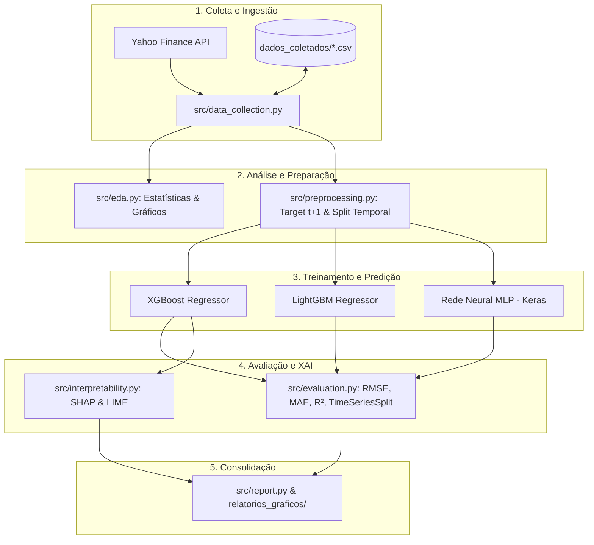

# 📑 Documentação Técnica e Metodológica do Projeto

> **Trabalho de Conclusão de Curso (TCC)**  
> **Curso:** Tecnologia em Gestão de Dados  
> **Instituição:** Universidade Federal do Piauí (UFPI) — Centro de Educação Aberta e a Distância (CEAD)  
> **Autora:** Lorrana Evelyn de Araújo Pereira  
> **Tema:** Previsão de Riscos Financeiros com Data Science, Machine Learning e Deep Learning  
> **Repositório:** [github.com/LorranaAraujo/Previsao_Financial_Risk](https://github.com/LorranaAraujo/Previsao_Financial_Risk)

---

## 📌 Sumário

1. [Visão Geral e Contextualização do Problema](#1-visão-geral-e-contextualização-do-problema)
2. [Fundamentação Teórica e Formulação Matemática](#2-fundamentação-teórica-e-formulação-matemática)
3. [Dicionário de Dados e Atributos (Features)](#3-dicionário-de-dados-e-atributos-features)
4. [Arquitetura do Pipeline e Engenharia de Software](#4-arquitetura-do-pipeline-e-engenharia-de-software)
5. [Detalhamento dos Módulos e Funções do Sistema](#5-detalhamento-dos-módulos-e-funções-do-sistema)
6. [Algoritmos de Machine Learning e Hiperparâmetros](#6-algoritmos-de-machine-learning-e-hiperparâmetros)
7. [Metodologia de Validação e Métricas de Avaliação](#7-metodologia-de-validação-e-métricas-de-avaliação)
8. [Inteligência Artificial Explicável (XAI) com SHAP e LIME](#8-inteligência-artificial-explicável-xai-com-shap-e-lime)
9. [Guia de Operação e Linha de Comando (CLI)](#9-guia-de-operação-e-linha-de-comando-cli)
10. [Catálogo de Artefatos Gerados](#10-catálogo-de-artefatos-gerados)
11. [Governança de Dados e Reprodutibilidade](#11-governança-de-dados-e-reprodutibilidade)
12. [Referências Bibliográficas](#12-referências-bibliográficas)

---

## 1. Visão Geral e Contextualização do Problema

O mercado de capitais é caracterizado pela alta volatilidade, não-linearidade e sensibilidade a choques macroeconômicos e geopolíticos. A gestão de risco de mercado é um dos pilares da moderna teoria financeira e das diretrizes regulatórias internacionais (tais como os acordos de Basileia).

### Objetivo Principal
Desenvolver e avaliar um pipeline de Ciência de Dados ponta a ponta capaz de prever a **volatilidade histórica anualizada (janela móvel de 21 dias úteis) no horizonte de 1 dia à frente ($t+1$)**, utilizando séries temporais do índice acionário brasileiro **IBOVESPA (`^BVSP`)**, complementadas por ativos de alta liquidez da B3 e do índice norte-americano **S&P 500 (`^GSPC`)**.

### Relevância para Gestão de Dados
- **Qualidade e integridade:** Coleta automatizada com higienização de desdobramentos e proventos (*Adjusted Close*).
- **Temporalidade estrita:** Prevenção contra vazamento de dados (*data leakage*) e viés de antecipação (*look-ahead bias*).
- **Transparência algorítmica:** Adoção de técnicas de *Explainable AI* (XAI) para auditoria e governança regulatória.

---

## 2. Fundamentação Teórica e Formulação Matemática

### 2.1. Retorno Diário Aritmético
O retorno diário $R_t$ mede a variação relativa do preço de fechamento ajustado entre dois pregões consecutivos:

$$R_t = \frac{P_t - P_{t-1}}{P_{t-1}} = \frac{P_t}{P_{t-1}} - 1$$

Onde:
- $P_t$: Preço de fechamento ajustado no instante $t$.
- $P_{t-1}$: Preço de fechamento ajustado no instante $t-1$.

### 2.2. Volatilidade Histórica Anualizada (Janela Móvel de 21 Dias)
A volatilidade é expressa como o desvio padrão amostral dos retornos diários ao longo de uma janela de 21 pregões úteis ($\approx 1$ mês de negociação), ajustada pelo fator de anualização $\sqrt{252}$:

$$\sigma_{t, 21d} = \sqrt{\frac{1}{N - 1} \sum_{i=0}^{N-1} \left( R_{t-i} - \bar{R}_t \right)^2} \times \sqrt{252}$$

Onde:
- $N = 21$ (número de dias úteis na janela).
- $\bar{R}_t = \frac{1}{N} \sum_{i=0}^{N-1} R_{t-i}$ (retorno médio diário na janela).
- $252$: Média de dias úteis de negociação por ano na B3 e mercados globais.

### 2.3. Variável-Alvo ($Target_{t+1}$)
O problema é modelado como **regressão supervisionada temporal em 1 passo à frente**:

$$Y_t = \sigma_{t+1, 21d}$$

No pré-processamento, essa variável é construída aplicando o deslocamento temporal negativo `shift(-1)` sobre a série de volatilidade.

### 2.4. Índice de Força Relativa (RSI - 14 Dias)
O RSI quantifica a velocidade e magnitude dos movimentos direcionais de preço:

$$RSI = 100 - \left( \frac{100}{1 + RS} \right), \quad RS = \frac{\overline{Ganho}_{14}}{\overline{Perda}_{14}}$$

### 2.5. Médias Móveis Simples (SMA)
Suavizam ruídos de curto e médio prazo:

$$SMA_{k, t} = \frac{1}{k} \sum_{i=0}^{k-1} P_{t-i}, \quad k \in \{20, 50\}$$

---

## 3. Dicionário de Dados e Atributos (Features)

A tabela abaixo descreve cada coluna processada e utilizada pelo pipeline preditivo:

| Nome da Coluna | Tipo | Origem / Cálculo | Papel no Modelo | Descrição e Interpretação Financeira |
|---|---|---|---|---|
| `Data` | `datetime64[ns]` | Yahoo Finance | Metadado / Eixo Temporal | Data de encerramento do pregão financeiro. |
| `Close` | `float64` | Yahoo Finance | Feature | Preço de fechamento ajustado para dividendos e desdobramentos. |
| `Volume` | `float64` | Yahoo Finance | Feature | Quantidade financeira negociada no pregão diário. |
| `Retorno_Diario` | `float64` | `Close.pct_change()` | Feature | Taxa percentual de valorização/desvalorização diária do ativo. |
| `Volatilidade_21d` | `float64` | $\text{std}(R_{21}) \times \sqrt{252}$ | Feature | Volatilidade anualizada calculada na janela histórica de 21 dias. |
| `MM_20d` | `float64` | $\text{mean}(P_{20})$ | Feature | Média móvel de 20 pregões (tendência de curtíssimo/curto prazo). |
| `MM_50d` | `float64` | $\text{mean}(P_{50})$ | Feature | Média móvel de 50 pregões (suporte e resistência de médio prazo). |
| `RSI_14d` | `float64` | RSI oscilador [0, 100] | Feature | Momentum do mercado; identifica zonas de sobrecompra (>70) ou sobrevenda (<30). |
| `Volume_MM20` | `float64` | $\text{mean}(Vol_{20})$ | Feature | Volume médio móvel de 20 dias, indicando liquidez e confirmação de movimentos. |
| `Target_Vol` | `float64` | `Volatilidade_21d.shift(-1)` | **Variável-Alvo ($y$)** | Volatilidade histórica observada no pregão seguinte ($t+1$). |

---

## 4. Arquitetura do Pipeline e Engenharia de Software

O sistema adota uma arquitetura modularizada, desacoplada e orientada a dados:



### Princípios de Engenharia Adotados
1. **Configuração Centralizada:** Parâmetros definidos em [`src/config.py`](src/config.py), permitindo reprodutibilidade e ajustes sem modificação de lógica interna.
2. **Dataclasses Tipadas:** Uso de [`DatasetModelagem`](src/preprocessing.py) para transporte seguro e tipado de arrays, matrizes escalonadas e metadados.
3. **Prevenção de Vazamento (Data Leakage):**
   - O `StandardScaler` é ajustado estritamente em `X_train` (`fit_transform`) e replicado em `X_test` (`transform`).
   - O particionamento é puramente sequencial temporal (sem `shuffle`).

---

## 5. Detalhamento dos Módulos e Funções do Sistema

### 5.1. [`src/config.py`](src/config.py)
Armazena caminhos de arquivos, listas de tickers, hiperparâmetros e variáveis de controle:
- `ATIVOS`: Dicionário com ações brasileiras (`PETR4.SA`, `VALE3.SA`, `ITUB4.SA`, `BBDC4.SA`, `ABEV3.SA`) e índices (`^BVSP`, `^GSPC`).
- `DATA_INICIO`: Marco inicial da coleta temporal (`2016-01-01`).
- `TEST_SIZE`: Fração da base reservada para teste (`0.20`, equivalente a 80% treino / 20% teste).
- `RANDOM_STATE`: Semente pseudoaleatória fixada em `42`.

### 5.2. [`src/data_collection.py`](src/data_collection.py)
Responsável pelo pipeline de ETL e engenharia de atributos:
- `calcular_rsi()`: Calcula o Índice de Força Relativa com proteção contra divisões por zero.
- `engenharia_atributos()`: Adiciona retornos, volatilidades anualizadas, médias móveis e volume médio.
- `baixar_ativo()`: Faz a requisição à API Yahoo Finance, trata MultiIndex de colunas e enriquece a série.
- `coletar_todos_ativos()`: Itera sobre todos os ativos catalogados e persiste os arquivos CSV em subdiretórios específicos.
- `carregar_ativo_local()`: Recupera dados pré-coletados em disco, evitando chamadas repetitivas de rede.

### 5.3. [`src/eda.py`](src/eda.py)
Módulo analítico e estatístico:
- `gerar_estatisticas_descritivas()`: Exibe média, desvio, mediana, curtose e assimetria dos retornos e volatilidade.
- `plotar_fechamento_e_medias()`: Gráfico interativo em Plotly de preços e médias móveis.
- `plotar_volatilidade_historica()`: Gráfico interativo com regime de volatilidade em área.
- `plotar_distribuicao_retornos()`: Histograma com KDE e Q-Q Plot para comprovação de caudas pesadas (leptocurtose).
- `plotar_matriz_correlacao()`: Heatmap de correlação de Pearson entre retornos diários dos ativos monitorados.
- `executar_eda_completa()`: Orquestrador de toda a análise exploratória.

### 5.4. [`src/preprocessing.py`](src/preprocessing.py)
- `DatasetModelagem`: Contêiner tipado com `X_train`, `X_test`, versões escalonadas, labels e datas.
- `preparar_dados_modelagem()`: Executa a defasagem temporal de 1 dia (`shift(-1)`), higienização de nulos, split temporal (80/20) e padronização estatística.

### 5.5. [`src/models.py`](src/models.py)
- `treinar_xgboost()`: Ajusta o modelo XGBoost Regressor.
- `treinar_lightgbm()`: Ajusta o modelo LightGBM Regressor.
- `construir_rede_neural()`: Compila a arquitetura MLP Keras com Dropout e saída reescalada para a escala do alvo.
- `treinar_rede_neural()`: Treina a rede MLP com Early Stopping para monitorar perda de validação.
- `treinar_todos_modelos()`: Orquestra o treinamento concorrente dos três modelos preditivos.

### 5.6. [`src/evaluation.py`](src/evaluation.py)
- `calcular_metricas()`: Extrai RMSE, MAE e $R^2$.
- `avaliar_todos_modelos()`: Constrói ranking consolidado pelo critério do menor RMSE.
- `validacao_cruzada_temporal()`: Validação cruzada estrita em séries temporais (`TimeSeriesSplit`) com 5 folds progressivos.
- `plotar_real_vs_predicoes()`: Gráfico interativo comparativo de séries temporais reais vs previstas.
- `plotar_curva_aprendizado_nn()`: Curva de convergência e loss de treino vs validação da MLP.

### 5.7. [`src/interpretability.py`](src/interpretability.py)
- `explicar_com_shap()`: Gera gráficos globais (Bar e Beeswarm) e local (Waterfall) baseados em Teoria dos Jogos.
- `explicar_com_lime()`: Gera explicações locais agnósticas através de aproximações lineares.

### 5.8. [`src/report.py`](src/report.py)
- `gerar_relatorio_final()`: Sintetiza a performance numérica em terminal e exporta o arquivo [`relatorios_graficos/relatorio_final_modelos.txt`](relatorios_graficos/relatorio_final_modelos.txt).

### 5.9. [`main.py`](main.py)
CLI principal que implementa `argparse` para orquestração modular de todas as fases.

---

## 6. Algoritmos de Machine Learning e Hiperparâmetros

### 6.1. XGBoost Regressor (Extreme Gradient Boosting)
Árvores de decisão treinadas sequencialmente, minimizando uma função de perda regularizada:

$$\mathcal{L}^{(t)} = \sum_{i=1}^n l(y_i, \hat{y}_i^{(t-1)} + f_t(x_i)) + \Omega(f_t)$$

- **Hiperparâmetros Configurados:**
  - `n_estimators`: 500
  - `learning_rate`: 0.05
  - `max_depth`: 5
  - `subsample`: 0.8
  - `colsample_bytree`: 0.8

### 6.2. LightGBM Regressor (Light Gradient Boosting Machine)
Otimização baseada em histogramas e crescimento de árvores orientado a folhas (*leaf-wise*), resultando em menor perda por split:
- **Hiperparâmetros Configurados:**
  - `n_estimators`: 500
  - `learning_rate`: 0.05
  - `num_leaves`: 31
  - `subsample`: 0.8
  - `colsample_bytree`: 0.8

### 6.3. Rede Neural MLP (Perceptron Multicamadas via Keras)
Arquitetura profunda feedforward com controle estrito de variância:
- **Camada de Entrada:** 8 neurônios (correspondente às 8 features de entrada).
- **Camada Oculta 1:** 128 neurônios com ativação ReLU, seguida de *Dropout* de 10% ($p=0.1$).
- **Camada Oculta 2:** 64 neurônios com ativação ReLU, seguida de *Dropout* de 10% ($p=0.1$).
- **Camada Oculta 3:** 32 neurônios com ativação ReLU.
- **Camada de Saída:** 1 neurônio linear seguido de uma camada `Rescaling` ($\hat{y} = z \cdot \sigma_y + \mu_y$, com $\mu_y$ e $\sigma_y$ do treino), para que a rede aprenda em escala padronizada e devolva a volatilidade na escala original.
- **Otimizador:** Adam ($\eta = 0.001$).
- **Early Stopping:** Parada precoce monitorando `val_loss` com paciência de 20 épocas. A validação usa os últimos 15% do conjunto de **treino** (ordem temporal preservada); o conjunto de teste não participa da escolha de épocas.
- *Batch Normalization* foi removida: com o alvo de baixa magnitude, ela levava a R² negativo no teste.

---

## 7. Metodologia de Validação e Métricas de Avaliação

### 7.1. Validação Cruzada Temporal (`TimeSeriesSplit`)
Em séries temporais financeiras, a validação cruzada tradicional $K$-Fold introduz vazamento de futuro para o passado (*look-ahead bias*), inflando artificialmente as métricas.

A validação temporal utiliza **janelas progressivas (5 folds)**:
- Fold 1: Treino em $T_1$, Teste em $T_2$.
- Fold 2: Treino em $T_1 \cup T_2$, Teste em $T_3$.
- ...
- Fold 5: Treino em $\bigcup_{i=1}^4 T_i$, Teste em $T_5$.

### 7.2. Métricas de Avaliação

1. **RMSE (Raiz do Erro Quadrático Médio):**
   $$RMSE = \sqrt{\frac{1}{n} \sum_{i=1}^n (y_i - \hat{y}_i)^2}$$
   Penaliza com maior rigor os desvios grandes, sendo crucial para gestão de risco de cauda (*tail risk*).

2. **MAE (Erro Médio Absoluto):**
   $$MAE = \frac{1}{n} \sum_{i=1}^n |y_i - \hat{y}_i|$$
   Representa o erro linear médio na mesma escala percentual da volatilidade.

3. **$R^2$ (Coeficiente de Determinação):**
   $$R^2 = 1 - \frac{\sum_{i=1}^n (y_i - \hat{y}_i)^2}{\sum_{i=1}^n (y_i - \bar{y})^2}$$
   Avalia a proporção da variância da volatilidade explicada pelos modelos preditivos.

---

## 8. Inteligência Artificial Explicável (XAI) com SHAP e LIME

Modelos em finanças e gestão de risco exigem auditabilidade e conformidade com princípios éticos e regulatórios.

### 8.1. SHAP (*SHapley Additive exPlanations*)
Baseado na teoria dos jogos cooperativos (Lloyd Shapley, 1953), decompõe a previsão de cada instância como a soma das contribuições marginais de cada variável:

$$\hat{y}(x) = \phi_0 + \sum_{j=1}^M \phi_j(x)$$

Onde:
- $\phi_0$: Valor esperado (base) da volatilidade média.
- $\phi_j(x)$: Contribuição marginal da feature $j$ na previsão do dia.

**Gráficos Gerados:**
- **Importância Global (Bar Plot):** Média dos valores absolutos dos SHAP values ($E[|\phi_j|]$).
- **Beeswarm Plot:** Revela se valores altos ou baixos de uma feature elevam ou reduzem o risco estimado.
- **Waterfall Plot:** Mostra a explicação detalhada passo a passo de uma previsão pontual.

### 8.2. LIME (*Local Interpretable Model-agnostic Explanations*)
O LIME aproxima o modelo complexo $f(x)$ localmente em torno de uma instância $x$ por meio de um modelo linear interpretável $g \in G$:

$$\xi(x) = \arg\min_{g \in G} \mathcal{L}(f, g, \pi_x) + \Omega(g)$$

Onde $\pi_x(z)$ pondera a proximidade das amostras perturbadas $z$ em relação a $x$.

---

## 9. Guia de Operação e Linha de Comando (CLI)

O orquestrador [`main.py`](file:///c:/Users/lorra/OneDrive/Documents/ESTUDOS/tcc/main.py) permite execução flexível via terminal.

### 9.1. Execução Completa (Pipeline de Ponta a Ponta)
Executa coleta, EDA, split, treino de 3 modelos, métricas, XAI e relatório:
```powershell
python main.py
```

### 9.2. Executar Utilizando Dados Locais Pré-Baixados
Evita requisições à internet utilizando os arquivos em `dados_coletados/`:
```powershell
python main.py --usar-dados-locais
```

### 9.3. Execução em Modo Não-Interativo (Headless)
Salva todos os gráficos em `relatorios_graficos/` sem abrir janelas interativas:
```powershell
python main.py --usar-dados-locais --nao-mostrar-graficos
```

### 9.4. Execução de Etapas Isoladas
```powershell
# Apenas Coleta de Dados
python main.py --etapa coleta

# Apenas Análise Exploratória (EDA)
python main.py --etapa eda --usar-dados-locais

# Apenas Treinamento de Modelos
python main.py --etapa treino --usar-dados-locais

# Apenas Avaliação e Métricas
python main.py --etapa avaliar --usar-dados-locais

# Apenas Interpretabilidade (SHAP e LIME)
python main.py --etapa interpretar --usar-dados-locais
```

### 9.5. Troca de Ativo sob Análise
```powershell
# Análise voltada para ações da Petrobras
python main.py --ticker PETR4.SA --usar-dados-locais
```

---

## 10. Catálogo de Artefatos Gerados

### Dados Brutos e Enriquecidos (`dados_coletados/`)
- `indices/IDX_BVSP.csv`: Histórico enriquecido do IBOVESPA.
- `indices/IDX_GSPC.csv`: Histórico enriquecido do S&P 500.
- `acoes_br/PETR4.csv`, `VALE3.csv`, `ITUB4.csv`, `BBDC4.csv`, `ABEV3.csv`: Séries enriquecidas das ações.

### Relatórios e Visualizações (`relatorios_graficos/`)
- `eda_fechamento_medias_BVSP.html`: Gráfico interativo com preços históricos e médias de 20 e 50 dias.
- `eda_volatilidade_BVSP.html`: Gráfico interativo destacando regimes de alta e baixa volatilidade.
- `eda_distribuicao_retornos_BVSP.png`: Histograma, KDE e Q-Q Plot comprovando a não-normalidade dos retornos.
- `eda_matriz_correlacao_ativos.png`: Matriz de correlação de retornos entre os 7 ativos monitorados.
- `avaliacao_real_vs_modelos.html`: Série temporal comparando a volatilidade real versus previsões dos 3 modelos.
- `avaliacao_curva_aprendizado_nn.png`: Curva de perda (loss MSE) e validação da Rede Neural MLP.
- `shap_importancia_global_bar.png`: Ranking de importância das features calculado pelo SHAP.
- `shap_beeswarm.png`: Dispersão do impacto marginal das variáveis sobre o modelo XGBoost.
- `shap_waterfall_amostra_10.png`: Decomposição aditiva individual da previsão para a 10ª amostra de teste.
- `lime_explicacao_amostra_10.png`: Coeficientes interpretáveis locais gerados pelo LIME.
- `relatorio_final_modelos.txt`: Tabela com métricas consolidadas (RMSE, MAE, R²) e identificação do modelo campeão.

---

## 11. Governança de Dados e Reprodutibilidade

1. **Reprodutibilidade:** Sementes pseudoaleatórias fixadas (`random_state=42`) para XGBoost, LightGBM, Keras e divisões de dados.
2. **Higienização de Valores Faltantes:** As janelas móveis geram valores nulos nas $k$ primeiras observações; estes são removidos de forma consistente com `dropna()`.
3. **Isolamento de Variáveis:** O alvo temporal utiliza `shift(-1)`, de modo que no instante $t$ o modelo possui acesso estritamente a informações disponíveis até o fechamento daquele dia.
4. **Armazenamento Estruturado:** Dados organizados em CSV com separação lógica entre índices e ações individuais.

---

## 12. Referências Bibliográficas

1. **HULL, John C.** *Opções, Futuros e Outros Derivativos*. 10. ed. São Paulo: Bookman, 2018.
2. **MARKOWITZ, Harry.** *Portfolio Selection*. The Journal of Finance, v. 7, n. 1, p. 77-91, 1952.
3. **CHEN, Tianqi; GUESTRIN, Carlos.** *XGBoost: A Scalable Tree Boosting System*. In: ACM SIGKDD International Conference on Knowledge Discovery and Data Mining, 2016.
4. **KE, Guolin et al.** *LightGBM: A Highly Efficient Gradient Boosting Decision Tree*. Advances in Neural Information Processing Systems (NeurIPS), 2017.
5. **LUNDBERG, Scott M.; LEE, Su-In.** *A Unified Approach to Interpreting Model Predictions*. Advances in Neural Information Processing Systems (NeurIPS), 2017.
6. **RIBEIRO, Marco Tulio; SINGH, Sameer; GUESTRIN, Carlos.** *"Why Should I Trust You?": Explaining the Predictions of Any Classifier*. In: ACM SIGKDD, 2016.
7. **HASTIE, Trevor; TIBSHIRANI, Robert; FRIEDMAN, Jerome.** *The Elements of Statistical Learning: Data Mining, Inference, and Prediction*. 2. ed. Springer, 2009.
8. **GOODFELLOW, Ian; BENGIO, Yoshua; COURVILLE, Aaron.** *Deep Learning*. MIT Press, 2016.
