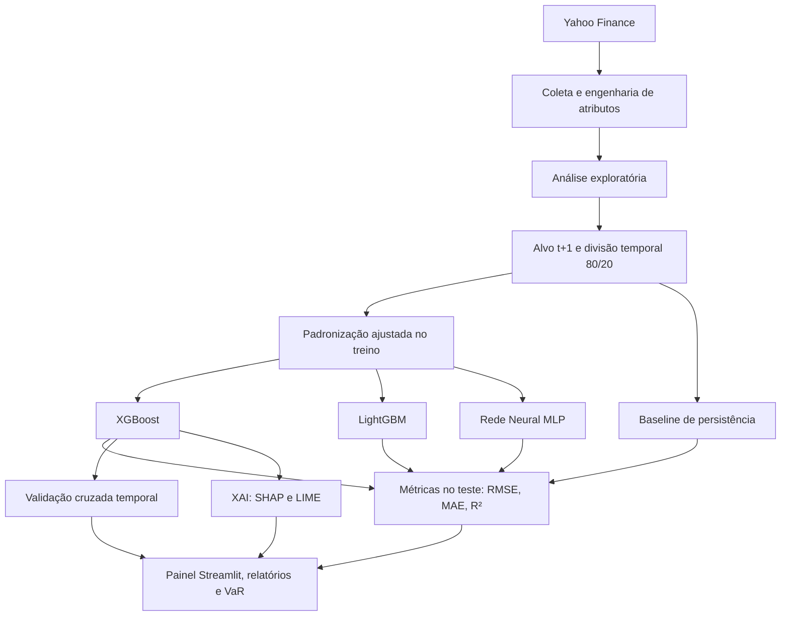
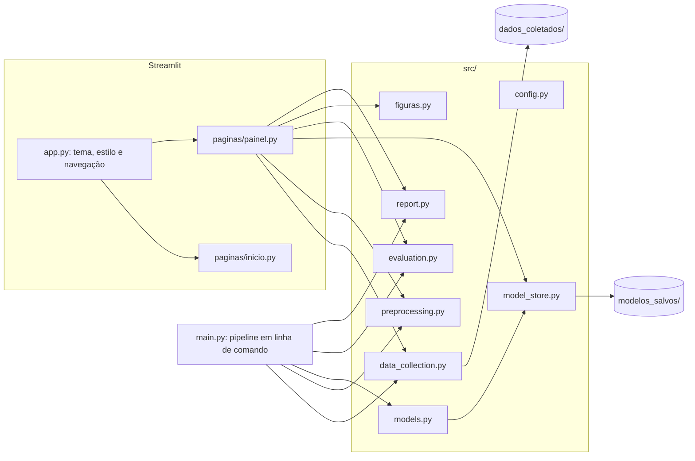

# Previsão de Riscos Financeiros com Data Science e Machine Learning


Trabalho de Conclusão de Curso que desenvolve um pipeline de Ciência de Dados, de ponta a ponta, para **prever a volatilidade do próximo pregão** de ações da B3 e de índices de mercado, comparar modelos de Machine Learning com uma regra de referência, **explicar cada previsão** (XAI) e traduzir o risco projetado em **Value at Risk (VaR)**. Os resultados são apresentados num painel web interativo em Streamlit.

| | |
|---|---|
| **Instituição** | Universidade Federal do Piauí (UFPI) |
| **Centro** | Centro de Educação Aberta e a Distância (CEAD) |
| **Curso** | Curso Superior de Tecnologia em Gestão de Dados |
| **Orientador** | Prof. Dr. Arlino Henrique Magalhães de Araújo |
| **Autora** | Lorrana Evelyn de Araújo Pereira |
| **Ano** | 2026 |

---

## Sumário

1. [Visão geral](#visão-geral)
2. [Principais resultados](#principais-resultados)
3. [Funcionalidades do painel](#funcionalidades-do-painel)
4. [Dados e variáveis](#dados-e-variáveis)
5. [Metodologia](#metodologia)
6. [Modelos e hiperparâmetros](#modelos-e-hiperparâmetros)
7. [Avaliação e validação](#avaliação-e-validação)
8. [Interpretabilidade (XAI)](#interpretabilidade-xai)
9. [Simulador de risco e Value at Risk](#simulador-de-risco-e-value-at-risk)
10. [Arquitetura do sistema](#arquitetura-do-sistema)
11. [Estrutura do repositório](#estrutura-do-repositório)
12. [Instalação](#instalação)
13. [Como executar](#como-executar)
14. [Implantação no Streamlit Community Cloud](#implantação-no-streamlit-community-cloud)
15. [Artefatos gerados](#artefatos-gerados)
16. [Limitações e trabalhos futuros](#limitações-e-trabalhos-futuros)
17. [Tecnologias](#tecnologias)
18. [Créditos e licenças de terceiros](#créditos-e-licenças-de-terceiros)
19. [Documentação complementar](#documentação-complementar)

---

## Visão geral

A gestão de riscos depende de estimar quanto um ativo pode oscilar no curto prazo. Este projeto modela a **volatilidade histórica anualizada em janela móvel de 21 pregões**, projetada **um pregão à frente (t+1)**, como um problema de regressão em série temporal.

- **Ativo de referência do estudo:** IBOVESPA (`^BVSP`).
- **Demais ativos monitorados:** S&P 500 (`^GSPC`), Petrobras (`PETR4.SA`), Vale (`VALE3.SA`), Itaú Unibanco (`ITUB4.SA`), Bradesco (`BBDC4.SA`) e Ambev (`ABEV3.SA`).
- **Abordagens comparadas:** XGBoost, LightGBM, Rede Neural MLP (Keras) e um **baseline de persistência** (a volatilidade de amanhã igual à de hoje), usado como referência mínima de desempenho.
- **Cuidados metodológicos:** divisão temporal sem embaralhamento, padronização ajustada só no treino, validação cruzada temporal e modelos treinados separadamente para cada ativo.

---

## Principais resultados

Resultados no conjunto de teste do ativo de referência (`^BVSP`, 20% finais da série, 527 pregões):

| Modelo | RMSE | MAE | R² |
|---|---:|---:|---:|
| **Baseline de persistência** (σ<sub>t+1</sub> = σ<sub>t</sub>) | **0,01185** | **0,00601** | **0,9299** |
| XGBoost | 0,01406 | 0,00895 | 0,9013 |
| LightGBM | 0,01496 | 0,00959 | 0,8883 |
| Rede Neural (MLP) | 0,02419 | 0,01625 | 0,7080 |

RMSE e MAE estão na escala da volatilidade anualizada (0,01 = 1 ponto percentual).

- **O baseline de persistência obteve o menor erro**: o RMSE do melhor modelo de Machine Learning (XGBoost) ficou 18,6% acima do RMSE do baseline (equivalente a um RMSE do baseline 15,7% menor). O resultado é coerente com a forte autocorrelação da volatilidade em janela móvel: de um pregão para o seguinte, 20 dos 21 retornos da janela se repetem.
- Entre os modelos de Machine Learning, o **XGBoost** teve o melhor desempenho.
- A **validação cruzada temporal** do XGBoost (5 folds) teve RMSE médio de 0,05015 ± 0,07255, com o maior erro no período de 10/2019 a 07/2021, que inclui o choque da pandemia.
- A variável mais influente nas previsões, segundo o SHAP, é a **volatilidade atual (`Volatilidade_21d`)**.
- O treinamento da rede neural não é determinístico; as métricas da MLP podem variar levemente a cada novo treino.

---

## Funcionalidades do painel

O sistema é uma aplicação Streamlit com duas páginas.

### Página inicial (rota `/`)
- Apresentação com frase de efeito e botão **Get Started**, que leva ao painel.
- **Vídeo curto** (animação de cerca de 27 segundos) gerado a partir dos dados reais: logotipos dos ativos, volatilidade histórica, comparação de modelos, importância SHAP e medidor de regime de risco.
- Números do projeto, **tutorial breve** com as seis abas do painel e **primeiros passos**.
- Botão discreto **Informações acadêmicas**, que abre uma janela com instituição, centro, curso, orientador, autora, ano, metodologia e tecnologias, com os logotipos da UFPI e do CEAD.

### Painel de análise (rota `/painel`)
A barra lateral traz o ícone de retorno à página inicial, a **seleção do ativo**, o **estado da modelagem** e o botão **Atualizar Séries Temporais** (novo download do Yahoo Finance). O cabeçalho exibe o logotipo, o ticker e o nome do ativo selecionado.

| Aba | Conteúdo |
|---|---|
| **Fundamentação e Metodologia** | Indicadores da série, problema de pesquisa, formulação matemática, fluxo metodológico e dicionário de dados |
| **Análise Exploratória** | Preço com médias móveis, volatilidade histórica, distribuição dos retornos contra a Normal, Q-Q plot, assimetria e curtose em excesso, e matriz de correlação entre os ativos (cada par exibido uma única vez) |
| **Desempenho dos Modelos** | Métricas no teste, comparação explícita com o baseline, tabela classificada, série real contra previsões, validação cruzada temporal e curva de aprendizado da MLP; treino com um clique para ativos ainda sem modelo |
| **Interpretabilidade (XAI)** | Importância global e beeswarm SHAP, seleção de um pregão por data e decomposição local da previsão (waterfall SHAP e LIME) |
| **Simulador de Risco e VaR** | Volatilidade projetada para o próximo pregão, regime de risco relativo ao histórico do ativo e calculadora de VaR diário a 95% e 99% |
| **Relatórios e Downloads** | Relatório consolidado gerado na hora, CSV de métricas, CSV dos dados do ativo e catálogo de 12 figuras PNG em alta resolução |

Convenções adotadas em todo o sistema:
- **Formato brasileiro** em números, valores monetários, eixos e rótulos de gráficos (vírgula decimal e ponto no milhar) e datas no formato dd/mm/aaaa.
- **Horário oficial de Brasília** (`America/Sao_Paulo`) em relatórios e registros, independentemente do fuso do servidor.
- **Modelos por ativo:** um modelo treinado em um ativo nunca é aplicado a outro, pois a escala e o regime de volatilidade de cada série são distintos.

---

## Dados e variáveis

- **Fonte:** Yahoo Finance, via `yfinance`, com preços ajustados por proventos e desdobramentos (`auto_adjust=True`).
- **Período:** cotações diárias a partir de 01/01/2016 até a data da coleta.
- **Armazenamento:** arquivos CSV em `dados_coletados/acoes_br/` e `dados_coletados/indices/`.

| Variável | Descrição |
|---|---|
| `Close` | Preço de fechamento ajustado |
| `Volume` | Volume negociado no pregão |
| `Retorno_Diario` | Variação percentual diária do fechamento |
| `Volatilidade_21d` | Desvio-padrão dos retornos em 21 pregões, anualizado por √252 |
| `MM_20d`, `MM_50d` | Médias móveis simples de 20 e 50 pregões |
| `RSI_14d` | Índice de Força Relativa de 14 pregões |
| `Volume_MM20` | Média móvel de 20 pregões do volume |
| `Target_Vol` | **Variável-alvo:** `Volatilidade_21d` do pregão seguinte (t+1), obtida com `shift(-1)` |

As oito primeiras variáveis são as *features* dos modelos.

---

## Metodologia



1. **Coleta e engenharia de atributos** (`src/data_collection.py`): download das séries e cálculo dos indicadores técnicos.
2. **Análise exploratória** (`src/eda.py` e aba do painel): estatísticas descritivas, fatos estilizados (caudas pesadas) e correlação entre os ativos.
3. **Pré-processamento** (`src/preprocessing.py`): criação do alvo t+1, remoção das linhas sem histórico suficiente, **divisão temporal 80/20 sem embaralhamento** e `StandardScaler` ajustado apenas no treino, o que evita vazamento de informação do futuro (*look-ahead bias*).
4. **Modelagem** (`src/models.py`): treino dos três modelos e persistência por ativo (`src/model_store.py`).
5. **Avaliação** (`src/evaluation.py`): métricas no teste, comparação com o baseline e validação cruzada temporal.
6. **Interpretabilidade** (`src/interpretability.py` e aba XAI): explicações globais e locais.
7. **Comunicação dos resultados:** painel interativo, relatório consolidado, arquivos CSV e figuras.

---

## Modelos e hiperparâmetros

Os parâmetros ficam centralizados em `src/config.py`.

| Modelo | Configuração |
|---|---|
| **XGBoost Regressor** | 500 árvores, `learning_rate` 0,05, `max_depth` 5, `subsample` 0,8, `colsample_bytree` 0,8 |
| **LightGBM Regressor** | 500 árvores, `learning_rate` 0,05, `num_leaves` 31, `subsample` 0,8, `colsample_bytree` 0,8 |
| **Rede Neural MLP (Keras)** | Camadas densas 128 → 64 → 32 com ReLU e *Dropout* de 10%; saída linear seguida de `Rescaling` para a escala do alvo; Adam com taxa 0,001; até 200 épocas, lote de 32; *Early Stopping* com paciência de 20 épocas, validado nos últimos 15% do treino |
| **Baseline de persistência** | Previsão igual à volatilidade observada no pregão atual |

Semente aleatória fixa (`RANDOM_STATE = 42`) para reprodutibilidade dos modelos de árvore.

---

## Avaliação e validação

- **Métricas:** RMSE (*Root Mean Squared Error*), MAE (*Mean Absolute Error*) e R² (coeficiente de determinação), calculadas nos 20% finais da série.
- **Comparação com o benchmark:** o painel e o relatório indicam se o melhor modelo de Machine Learning supera o baseline de persistência e em quantos por cento.
- **Validação cruzada temporal:** `TimeSeriesSplit` com 5 folds sobre a série completa, sempre treinando no passado e validando no futuro, com o período de cada fold identificado.
- **Curva de aprendizado da MLP:** perda de treino e de validação por época, com a época escolhida pelo *Early Stopping*.

---

## Interpretabilidade (XAI)

- **SHAP (TreeExplainer sobre o XGBoost):** importância global (média de |SHAP|), beeswarm com a direção do efeito de cada variável e waterfall que decompõe a previsão de um pregão a partir do valor esperado do modelo.
- **LIME (tabular):** explicação linear local do mesmo pregão, com as condições expressas na escala original das variáveis.
- No painel, o pregão analisado é escolhido por **data**, e a decomposição local e as figuras do catálogo acompanham essa escolha.

---

## Simulador de risco e Value at Risk

- **Volatilidade projetada:** previsão do XGBoost a partir do último pregão disponível.
- **Regime de risco relativo ao próprio ativo**, pelos percentis da volatilidade histórica: baixo (abaixo de P25), moderado (P25 a P75), elevado (P75 a P95) e extremo (acima de P95).
- **VaR paramétrico de um dia:**

  VaR = z × (σ<sub>anual</sub> / √252) × Patrimônio, com z = 1,645 (95%) e z = 2,326 (99%).

O VaR paramétrico assume normalidade dos retornos no curtíssimo prazo. Como a análise exploratória mostra caudas pesadas, ele tende a subestimar perdas extremas.

---

## Arquitetura do sistema



- **`main.py`** executa o pipeline completo em linha de comando e grava modelos, figuras e relatório em disco.
- **O painel** reutiliza os mesmos módulos: carrega os modelos salvos (ou treina sob demanda), recalcula as métricas e gera relatórios e figuras na hora, para o ativo selecionado.
- **Caches do Streamlit** (`st.cache_data` e `st.cache_resource`) evitam recalcular dados, SHAP, LIME, validação cruzada e figuras a cada interação.

---

## Estrutura do repositório

```text
Previsao_Financial_Risk/
├── app.py                          # Ponto de entrada do Streamlit: tema, estilo e navegação
├── paginas/
│   ├── inicio.py                   # Página inicial (rota "/")
│   └── painel.py                   # Painel de análise (rota "/painel")
├── src/
│   ├── config.py                   # Caminhos, ativos, hiperparâmetros e fuso horário
│   ├── data_collection.py          # Coleta no Yahoo Finance e indicadores técnicos
│   ├── eda.py                      # Análise exploratória do pipeline
│   ├── preprocessing.py            # Alvo t+1, divisão temporal e padronização
│   ├── models.py                   # XGBoost, LightGBM e MLP
│   ├── model_store.py              # Persistência dos modelos por ativo
│   ├── evaluation.py               # Métricas, baseline e validação cruzada
│   ├── interpretability.py         # SHAP e LIME do pipeline
│   ├── figuras.py                  # Catálogo de figuras PNG do painel
│   └── report.py                   # Relatório consolidado e exportação em CSV
├── scripts/
│   ├── rasterizar_logos.py         # Converte os logotipos dos ativos em PNG
│   └── gerar_video_apresentacao.py # Gera o vídeo da página inicial
├── assets/
│   ├── style.css                   # Estilo visual do sistema
│   ├── ativos/                     # Logotipos dos ativos (e PNGs em ativos/png/)
│   ├── institucional/              # Logotipos da UFPI e do CEAD
│   └── video/apresentacao.gif      # Vídeo curto da página inicial
├── .streamlit/config.toml          # Tema do Streamlit
├── dados_coletados/                # Séries históricas em CSV
├── modelos_salvos/                 # Modelos do ativo de referência (demais em por_ativo/)
├── relatorios_graficos/            # Figuras, gráficos HTML e relatório do pipeline
├── main.py                         # Pipeline completo em linha de comando
├── requirements.txt                # Dependências
├── DOCUMENTACAO.md                 # Documentação técnica e metodológica detalhada
├── TCC_Previsao_Riscos_Financeiros.ipynb # Notebook de desenvolvimento
├── TCC- Artigo.pdf                 # Artigo do TCC
└── tcc_previsao_riscos_financeiros.py    # Script original de referência (legado)
```

---

## Instalação

**Pré-requisitos:** Python 3.10 ou superior e `git`.

```bash
git clone https://github.com/cleristoncramos/Previsao_Financial_Risk.git
cd Previsao_Financial_Risk
```

Crie e ative um ambiente virtual:

```bash
# Windows (PowerShell)
python -m venv venv
.\venv\Scripts\Activate.ps1

# Linux / macOS
python3 -m venv venv
source venv/bin/activate
```

Instale as dependências:

```bash
pip install -r requirements.txt
```

---

## Como executar

### Painel web

```bash
streamlit run app.py
```

Acesse `http://localhost:8501`. A página inicial abre na rota `/` e o painel em `/painel`. O repositório já inclui os dados e os modelos do ativo de referência; os demais ativos podem ser treinados pelo próprio painel, na aba **Desempenho dos Modelos**.

### Pipeline em linha de comando

| Comando | Efeito |
|---|---|
| `python main.py` | Pipeline completo: coleta, EDA, treino, avaliação, XAI e relatório |
| `python main.py --usar-dados-locais` | Usa os CSVs existentes, sem novo download |
| `python main.py --usar-dados-locais --carregar-modelos` | Usa os modelos salvos, sem retreinar |
| `python main.py --nao-mostrar-graficos` | Salva os gráficos sem abrir janelas (execução automatizada) |
| `python main.py --etapa {coleta, eda, treino, avaliar, interpretar}` | Executa apenas uma etapa |
| `python main.py --ticker PETR4.SA` | Estuda outro ativo (modelos salvos em `modelos_salvos/por_ativo/`) |

### Regenerar os recursos da página inicial

Depois de atualizar dados ou modelos do ativo de referência:

```bash
python scripts/rasterizar_logos.py
python scripts/gerar_video_apresentacao.py
```

O primeiro script usa o Chrome ou o Edge instalados, em modo headless, para converter os logotipos SVG em PNG.

---

## Implantação no Streamlit Community Cloud

1. Publique o repositório no GitHub.
2. Em [share.streamlit.io](https://share.streamlit.io), crie um app apontando para o repositório, o branch `main` e o arquivo principal **`app.py`**.
3. As dependências são instaladas a partir de `requirements.txt` (inclui `tzdata`, usado para o horário de Brasília).
4. Após enviar alterações em módulos de `src/` ou no `requirements.txt`, reinicie o app em **Manage app → Reboot app**, para que os módulos sejam recarregados.

---

## Artefatos gerados

**Pelo painel, para o ativo selecionado e no momento do download:**

| Arquivo | Conteúdo |
|---|---|
| `relatorio_desempenho_<ATIVO>_<data_hora>.txt` | Relatório com dados e metodologia, desempenho no teste, comparação com o benchmark, validação cruzada e conclusão |
| `metricas_modelos_<ATIVO>_<data_hora>.csv` | Uma linha por modelo, ordenada por RMSE, com classificação e data de geração |
| `dados_<ATIVO>_<data_hora>.csv` | Série diária com preços, indicadores e a volatilidade t+1 (alvo) |
| `<ATIVO>_<figura>.png` | 12 figuras em 1600 × 1000 px: exploratórias, de avaliação e de interpretabilidade |

Os CSVs seguem o padrão do Excel em português (ponto e vírgula entre colunas, vírgula decimal e datas dd/mm/aaaa).

**Pelo pipeline (`main.py`), em `relatorios_graficos/` e `modelos_salvos/`:** gráficos HTML interativos e PNG de EDA, avaliação, SHAP e LIME, o relatório `relatorio_final_modelos.txt`, a tabela `metricas_modelos.csv`, além dos modelos, do scaler e dos metadados de treino (`metadados_modelos.json`).

---

## Limitações e trabalhos futuros

- **Horizonte de um pregão:** a volatilidade em janela móvel é muito persistente, e o baseline de persistência é difícil de superar nesse horizonte. Horizontes mais longos (5 ou 21 pregões) tendem a favorecer os modelos de Machine Learning.
- **Atributos:** o conjunto de *features* é técnico e univariado. Incluir volatilidade implícita, variáveis macroeconômicas ou modelos da família GARCH como referência adicional pode enriquecer a comparação.
- **VaR paramétrico:** a hipótese de normalidade subestima eventos extremos. VaR histórico, simulação de Monte Carlo ou Expected Shortfall são extensões naturais.
- **Dados públicos:** a qualidade e a disponibilidade dependem do Yahoo Finance.
- **Reprodutibilidade da MLP:** o treinamento da rede neural varia levemente entre execuções.

---

## Tecnologias

| Categoria | Ferramentas |
|---|---|
| Linguagem | Python |
| Dados | `pandas`, `numpy`, `scipy`, `yfinance` |
| Machine Learning | `scikit-learn`, `xgboost`, `lightgbm` |
| Deep Learning | `tensorflow` / `keras` |
| Interpretabilidade | `shap`, `lime` |
| Visualização | `plotly`, `matplotlib`, `seaborn` |
| Interface | `streamlit` |
| Persistência e utilidades | `joblib`, `tzdata`, `Pillow` |

---

## Créditos e licenças de terceiros

- **Logotipos dos ativos:** Wikimedia Commons e Wikipédia, usados apenas para identificar os ativos analisados. Fontes e licenças em [`assets/ativos/FONTES.md`](assets/ativos/FONTES.md).
- **Logotipos da UFPI e do CEAD:** Wikimedia Commons e site institucional do CEAD/UFPI. Fontes em [`assets/institucional/FONTES.md`](assets/institucional/FONTES.md).
- **Dados de mercado:** Yahoo Finance, para fins acadêmicos.

As marcas pertencem às respectivas empresas e instituições.

---

## Documentação complementar

- [`DOCUMENTACAO.md`](DOCUMENTACAO.md): fundamentação teórica, formulação matemática, dicionário de dados, descrição dos módulos e guia de operação.
- `TCC- Artigo.pdf`: artigo do Trabalho de Conclusão de Curso.
- `TCC_Previsao_Riscos_Financeiros.ipynb`: notebook de desenvolvimento.

---

**Universidade Federal do Piauí (UFPI) · Centro de Educação Aberta e a Distância (CEAD)**
Curso Superior de Tecnologia em Gestão de Dados · Orientador: Prof. Dr. Arlino Henrique Magalhães de Araújo · Autora: Lorrana Evelyn de Araújo Pereira · 2026
