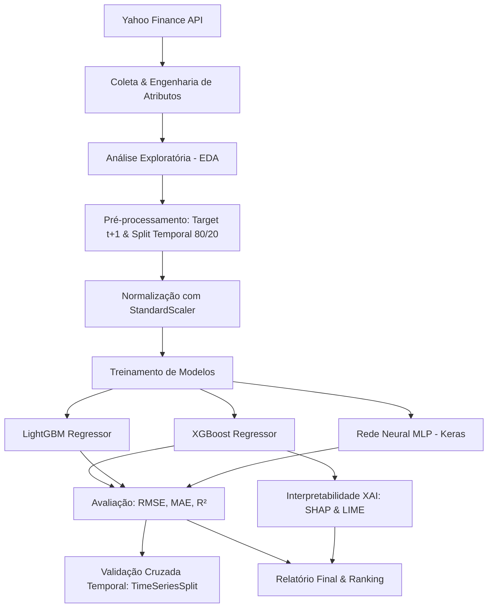

# 📈 Previsão de Riscos Financeiros com Data Science e Machine Learning

> **Trabalho de Conclusão de Curso (TCC)**  
> **Curso:** Tecnologia em Gestão de Dados — UFPI / CEAD  
> **Autora:** Lorrana Evelyn de Araújo Pereira  
> **Instituição:** Universidade Federal do Piauí (UFPI)  

---

## 🎯 Sobre o Projeto

Este projeto tem como objetivo desenvolver um pipeline completo de **Ciência de Dados**, **Machine Learning** e **Deep Learning** para a **previsão de risco e volatilidade de ativos financeiros**. 

Focado prioritariamente no índice **IBOVESPA (`^BVSP`)**, o sistema também coleta e processa séries históricas do **S&P 500 (`^GSPC`)** e de ações líquidas da B3 (**PETR4**, **VALE3**, **ITUB4**, **BBDC4**, **ABEV3**).

A variável-alvo modelada é a **volatilidade histórica anualizada calculada sobre uma janela móvel de 21 dias**, projetada **1 dia à frente ($t+1$)**. Trata-se de um problema de regressão temporal de alta relevância para gestão de riscos, precificação de derivativos e alocação de carteiras.

---

## 🏗️ Estrutura do Projeto

O código foi totalmente modularizado seguindo as melhores práticas de engenharia de software e ciência de dados:

```text
tcc/
├── app.py                     # Ponto de entrada do Streamlit: estilo e navegação entre as páginas
├── paginas/
│   ├── inicio.py              # Página inicial (rota "/"): apresentação, tutorial e informações acadêmicas
│   └── painel.py              # Painel de análise (rota "/painel"): EDA, modelos, XAI, VaR e relatórios
├── assets/
│   ├── style.css              # Estilo visual do painel e da página inicial
│   ├── ativos/                # Logotipos dos ativos (fontes e licenças em FONTES.md)
│   └── video/                 # Vídeo curto de apresentação exibido na página inicial
├── scripts/
│   ├── rasterizar_logos.py    # Converte os logotipos em PNG (usados no vídeo)
│   └── gerar_video_apresentacao.py # Gera o vídeo de apresentação a partir dos dados reais
├── .streamlit/config.toml     # Tema do Streamlit (claro, sem cantos arredondados)
├── dados_coletados/           # Diretório com os dados brutos e enriquecidos em CSV
│   ├── acoes_br/              # Séries temporais das ações da B3
│   └── indices/               # Séries temporais do IBOVESPA e S&P 500
├── modelos_salvos/            # Modelos treinados e scaler (ativo de referência na raiz; demais em por_ativo/)
├── relatorios_graficos/       # Gráficos (HTML interativo e PNG) e relatórios salvos pelo pipeline
├── src/                       # Pacote de módulos em Python
│   ├── __init__.py            # Inicializador do pacote
│   ├── config.py              # Parâmetros globais, tickers, hiperparâmetros, caminhos e fuso horário
│   ├── data_collection.py     # Coleta via Yahoo Finance e cálculo de indicadores técnicos
│   ├── eda.py                 # Análise Exploratória de Dados (EDA) e gráficos estatísticos
│   ├── preprocessing.py       # Preparação de target (t+1), split temporal e padronização
│   ├── models.py              # Definição e treinamento de XGBoost, LightGBM e MLP (Keras)
│   ├── model_store.py         # Persistência e carregamento dos modelos por ativo
│   ├── evaluation.py          # Métricas (RMSE, MAE, R²), TimeSeriesSplit e curvas de treino
│   ├── interpretability.py    # Explicabilidade dos modelos com SHAP e LIME (XAI)
│   ├── figuras.py             # Catálogo de figuras PNG geradas para o ativo selecionado
│   └── report.py              # Relatório consolidado e exportação dos arquivos CSV
├── main.py                    # Script principal orquestrador do pipeline (CLI)
├── requirements.txt           # Dependências e bibliotecas do projeto
├── README.md                  # Apresentação e guia rápido do projeto
├── DOCUMENTACAO.md            # Documentação técnica, matemática e metodológica detalhada
└── tcc_previsao_riscos_financeiros.py # Script original de referência (legado)
```

> 📖 Para uma descrição aprofundada das formulações matemáticas, dicionário de dados, explicabilidade (SHAP/LIME) e arquitetura de software, consulte o arquivo [DOCUMENTACAO.md](DOCUMENTACAO.md).

---

## 🔄 Fluxo Metodológico (Pipeline)



### 1. Coleta e Engenharia de Atributos (`src/data_collection.py`)
- Coleta automática diária a partir de `2016-01-01` usando a biblioteca `yfinance`.
- Atributos técnicos calculados:
  - **Retorno Diário:** Variação percentual diária do preço de fechamento ajustado.
  - **Volatilidade Histórica (21 dias):** Desvio padrão dos retornos diários multiplicado pelo fator anualizado ($\sqrt{252}$).
  - **Médias Móveis Simples:** Janelas de 20 e 50 dias (`MM_20d`, `MM_50d`).
  - **Índice de Força Relativa (RSI 14d):** Indicador de momentum sobre os ganhos e perdas médios.
  - **Média Móvel de Volume:** Janela de 20 dias (`Volume_MM20`).

### 2. Análise Exploratória dos Dados (`src/eda.py`)
- Estatísticas descritivas (média, desvio, quartis).
- Gráficos interativos em **Plotly** de fechamento, médias e evolução da volatilidade.
- Verificação de hipóteses de distribuição:
  - Análise de **Assimetria (Skewness)** e **Curtose (Kurtosis)**.
  - **Q-Q Plot** e Histograma com KDE, evidenciando as *caudas pesadas (distribuição leptocúrtica)* características do mercado financeiro.
- **Heatmap de Correlação** entre retornos dos ativos analisados.

### 3. Pré-processamento e Divisão dos Dados (`src/preprocessing.py`)
- Definição do target: $Volatilidade_{t+1}$ gerada via `shift(-1)`.
- **Split estritamente temporal (80% treino / 20% teste)**: sem embaralhamento (*no shuffle*), garantindo que dados futuros não vazem para o passado (*look-ahead bias*).
- **Normalização (StandardScaler)**: treinado unicamente com a base de treino e aplicado à base de teste.

### 4. Modelagem Preditiva (`src/models.py`)
Três arquiteturas distintas e complementares:
1. **XGBoost Regressor:** Árvores de decisão impulsionadas por gradiente com regularização.
2. **LightGBM Regressor:** Gradient boosting otimizado com divisão de folhas por profundidade e alta eficiência.
3. **Rede Neural MLP (Keras / TensorFlow):** Arquitetura profunda com camadas densas (128 $\rightarrow$ 64 $\rightarrow$ 32), camadas de *Dropout*, saída reescalada para a escala do alvo e parada antecipada (*Early Stopping*) validada no final do conjunto de treino.

### 5. Avaliação e Validação (`src/evaluation.py`)
- Métricas computadas sobre a base de teste:
  - **RMSE** (*Root Mean Squared Error*)
  - **MAE** (*Mean Absolute Error*)
  - **$R^2$** (*Coeficiente de Determinação*)
- **Validação Cruzada Temporal (TimeSeriesSplit):** Divisão progressiva em 5 folds para assegurar consistência do modelo em diferentes ciclos de mercado.

### 6. Interpretabilidade / Explainable AI (`src/interpretability.py`)
- **SHAP (*SHapley Additive exPlanations*):**
  - Gráfico de barras da importância global das variáveis.
  - *Beeswarm plot* demonstrando o impacto positivo/negativo de cada indicador nas projeções de volatilidade.
  - *Waterfall plot* detalhando o cálculo de uma previsão diária individual.
- **LIME (*Local Interpretable Model-agnostic Explanations*):**
  - Explicação local com coeficientes lineares interpretáveis para instâncias individuais.

---

## 💻 Instalação e Configuração

### Pré-requisitos
- **Python 3.10 ou superior** (recomendado Python 3.11).
- Gerenciador de pacotes `pip`.

### 1. Clonar ou Acessar a Pasta do Projeto
Abra o terminal no diretório do projeto:
```bash
cd c:\Users\lorra\OneDrive\Documents\ESTUDOS\tcc
```

### 2. Criar e Ativar o Ambiente Virtual
Recomenda-se o uso de um ambiente virtual isolado:

**No Windows (PowerShell):**
```powershell
python -m venv venv
.\venv\Scripts\Activate.ps1
```

**No Linux / macOS:**
```bash
python3 -m venv venv
source venv/bin/activate
```

### 3. Instalar as Dependências
Instale todas as bibliotecas necessárias com um único comando:
```bash
pip install -r requirements.txt
```

---

## 🚀 Como Executar

### 🌐 Execução do Dashboard Web Interativo (Streamlit)
Para iniciar a interface gráfica acadêmica e profissional com todas as análises, gráficos Plotly interativos, simulador de risco em tempo real e XAI:
```bash
streamlit run app.py
```
Acesse no seu navegador: `http://localhost:8501`.

### Execução Completa (Pipeline de Ponta a Ponta via CLI)
Para executar todas as etapas sequencialmente (download, EDA, treino, métricas, XAI e relatório):
```bash
python main.py
```

### Executar Utilizando Dados Locais e Modelos Persistidos (Inferência Instantânea)
Caso os dados já tenham sido baixados e os modelos salvos em `modelos_salvos/`:
```bash
python main.py --usar-dados-locais --carregar-modelos
```

### Execução em Modo Headless / Terminal (Salvar Gráficos sem Abrir Janelas)
Para execuções automatizadas em que você prefere apenas que os gráficos sejam salvos no diretório `relatorios_graficos/`:
```bash
python main.py --nao-mostrar-graficos
```

### Executar Etapas Específicas
Você pode utilizar o parâmetro `--etapa` para focar em uma fase do trabalho:

- **Apenas Coleta de Dados:**
  ```bash
  python main.py --etapa coleta
  ```
- **Apenas Análise Exploratória (EDA):**
  ```bash
  python main.py --etapa eda --usar-dados-locais
  ```
- **Apenas Treinamento:**
  ```bash
  python main.py --etapa treino --usar-dados-locais
  ```
- **Apenas Avaliação e Métricas:**
  ```bash
  python main.py --etapa avaliar --usar-dados-locais
  ```
- **Apenas Interpretabilidade (SHAP & LIME):**
  ```bash
  python main.py --etapa interpretar --usar-dados-locais
  ```

### Alterar Ativo de Estudo
Por padrão, o ativo principal é o IBOVESPA (`^BVSP`). Para testar com outro ativo (ex: Petrobras):
```bash
python main.py --ticker PETR4.SA
```

---

## 📊 Saídas e Artefatos Gerados

Após a execução, os seguintes artefatos são automaticamente criados:

1. **`dados_coletados/`**: 
   - Arquivos CSV com preços e indicadores calculados para cada ativo (`IDX_BVSP.csv`, `PETR4.csv`, etc.).
2. **`relatorios_graficos/`**:
   - `eda_fechamento_medias_BVSP.html`: Gráfico interativo com preços e médias móveis.
   - `eda_volatilidade_BVSP.html`: Gráfico em área da volatilidade histórica anualizada.
   - `eda_distribuicao_retornos_BVSP.png`: Histograma, KDE e Q-Q Plot.
   - `eda_matriz_correlacao_ativos.png`: Heatmap de correlações de retornos.
   - `avaliacao_real_vs_modelos.html`: Comparação interativa da volatilidade real vs. previsões dos 3 modelos.
   - `avaliacao_curva_aprendizado_nn.png`: Curva de perda (loss MSE) da Rede Neural.
   - `shap_importancia_global_bar.png`: Ranking de importância das features pelo SHAP.
   - `shap_beeswarm.png`: Distribuição do impacto de cada feature no modelo.
   - `shap_waterfall_amostra_10.png`: Explicabilidade local decomposta pelo SHAP.
   - `lime_explicacao_amostra_10.png`: Explicabilidade local calculada pelo LIME.
   - `relatorio_final_modelos.txt`: Relatório com as métricas consolidadas e identificação do melhor modelo.

---

## 📚 Tecnologias Empregadas

| Categoria | Bibliotecas / Ferramentas |
|---|---|
| **Linguagem** | Python 3.11 |
| **Manipulação de Dados** | `numpy`, `pandas`, `scipy` |
| **Dados de Mercado** | `yfinance` (Yahoo Finance API) |
| **Visualização de Dados** | `matplotlib`, `seaborn`, `plotly` |
| **Machine Learning** | `scikit-learn`, `xgboost`, `lightgbm` |
| **Deep Learning** | `tensorflow`, `keras` |
| **Interpretabilidade (XAI)** | `shap`, `lime` |

---

## 🎓 Autoria & Agradecimentos

- **Autora:** Lorrana Evelyn de Araújo Pereira  
- **Curso:** Tecnologia em Gestão de Dados  
- **Instituição:** Universidade Federal do Piauí (UFPI) — Centro de Educação Aberta e a Distância (CEAD)  
- **Tema:** Ciência de Dados aplicada ao Mercado Financeiro e Gestão de Riscos
